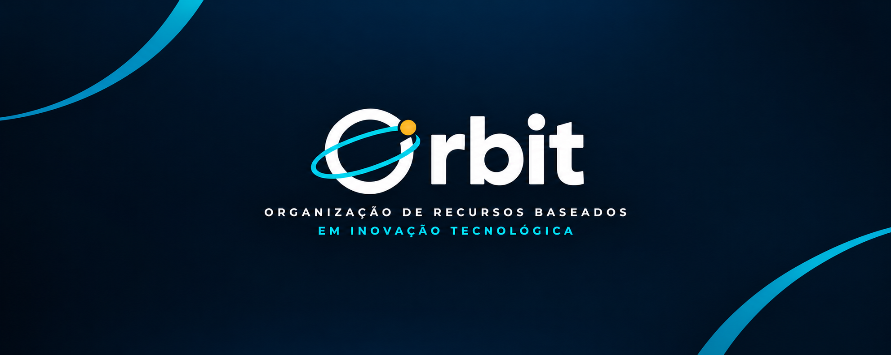

<!--
ORBIT — GitHub README
-->

 

# ORBIT

### Organização de Recursos Baseados em Inovação Tecnológica

**Technology. Innovation. Digital Solutions.**

A technology startup focused on developing digital solutions that make everyday life easier.

 

  

---

## Português

<a href="#sobre-a-orbit">Sobre</a> · <a href="#missao">Missão</a> · <a href="#visao">Visão</a> · <a href="#projetos">Projetos</a> · <a href="#tecnologias">Tecnologias</a>

### Sobre a ORBIT

A **ORBIT (Organização de Recursos Baseados em Inovação Tecnológica)** é uma startup dedicada ao desenvolvimento de soluções digitais que facilitam o dia a dia das pessoas.

Nosso propósito é transformar ideias em produtos tecnológicos capazes de resolver problemas reais, simplificar processos e proporcionar experiências mais eficientes.

Acreditamos que a tecnologia deve ser acessível, funcional e orientada às necessidades das pessoas.

### Nossa missão

Desenvolver soluções tecnológicas inovadoras que simplifiquem processos, solucionem problemas cotidianos e contribuam para uma experiência digital mais eficiente.

### Nossa visão

Construir um ecossistema de soluções digitais que conecte tecnologia, inovação e pessoas, criando ferramentas que gerem valor e transformem experiências.

### Nossos princípios

| Princípio | Descrição |
|---|---|
| Inovação | Explorar novas ideias e tecnologias para desenvolver soluções relevantes. |
| Eficiência | Simplificar processos por meio de aplicações práticas e funcionais. |
| Qualidade | Priorizar organização, confiabilidade e melhoria contínua. |
| Experiência | Criar soluções intuitivas, acessíveis e orientadas ao usuário. |
| Evolução | Aprender continuamente e expandir nossas possibilidades tecnológicas. |

### Projetos

Este repositório reúne os projetos, aplicações e iniciativas desenvolvidos pela Orbit.

Cada projeto representa uma oportunidade de aplicar tecnologia na resolução de problemas, explorar novas abordagens e construir soluções digitais.

Nosso desenvolvimento é orientado por:

- Código organizado e sustentável.
- Interfaces intuitivas e consistentes.
- Soluções eficientes e funcionais.
- Manutenção e evolução contínua.
- Boas práticas de desenvolvimento.

### Tecnologias

Utilizamos tecnologias e ferramentas adequadas às necessidades de cada projeto.

Nosso foco está na construção de soluções digitais organizadas, eficientes e sustentáveis, considerando tanto os requisitos técnicos quanto a experiência dos usuários.

As tecnologias utilizadas podem variar conforme o escopo e os objetivos de cada aplicação.

### Nossa jornada

Estamos construindo a Orbit com uma visão de longo prazo, desenvolvendo soluções que aproximam tecnologia e pessoas.

Este espaço representa nossa evolução, nossos projetos e nosso compromisso contínuo com a inovação.

**ORBIT**

Organização de Recursos Baseados em Inovação Tecnológica

*Tecnologia desenvolvida para facilitar o dia a dia.*

<a href="#english">Read in English ↓</a>

---

## English

<a href="#about-orbit">About</a> · <a href="#mission">Mission</a> · <a href="#vision">Vision</a> · <a href="#projects">Projects</a> · <a href="#technologies">Technologies</a>

### About ORBIT

**ORBIT (Organization of Resources Based on Technological Innovation)** is a technology startup dedicated to developing digital solutions that make everyday life easier.

Our purpose is to transform ideas into technological products that solve real-world problems, simplify processes, and deliver more efficient experiences.

We believe technology should be accessible, functional, and designed around people's needs.

### Our Mission

To develop innovative technological solutions that simplify processes, solve everyday challenges, and contribute to a more efficient digital experience.

### Our Vision

To build an ecosystem of digital solutions that connects technology, innovation, and people, creating tools that deliver value and transform experiences.

### Our Principles

| Principle | Description |
|---|---|
| Innovation | Explore new ideas and technologies to develop meaningful solutions. |
| Efficiency | Simplify processes through practical and functional applications. |
| Quality | Prioritize organization, reliability, and continuous improvement. |
| Experience | Create intuitive, accessible, and user-centered solutions. |
| Evolution | Continuously learn and expand our technological capabilities. |

### Projects

This repository brings together the projects, applications, and initiatives developed by Orbit.

Each project represents an opportunity to apply technology to real-world problems, explore new approaches, and build digital solutions.

Our development approach focuses on:

- Organized and maintainable code.
- Intuitive and consistent interfaces.
- Efficient and functional solutions.
- Continuous maintenance and improvement.
- Software development best practices.

### Technologies

We use technologies and tools selected according to the requirements of each project.

Our focus is on building organized, efficient, and sustainable digital solutions, considering both technical requirements and user experience.

The technologies we use may vary depending on the scope and objectives of each application.

### Our Journey

We are building Orbit with a long-term vision, developing solutions that bring technology and people closer together.

This space represents our evolution, our projects, and our ongoing commitment to innovation.

**ORBIT**

Organization of Resources Based on Technological Innovation

*Technology designed to make everyday life easier.*

<a href="#portugues">Voltar para Português ↑</a>

---

